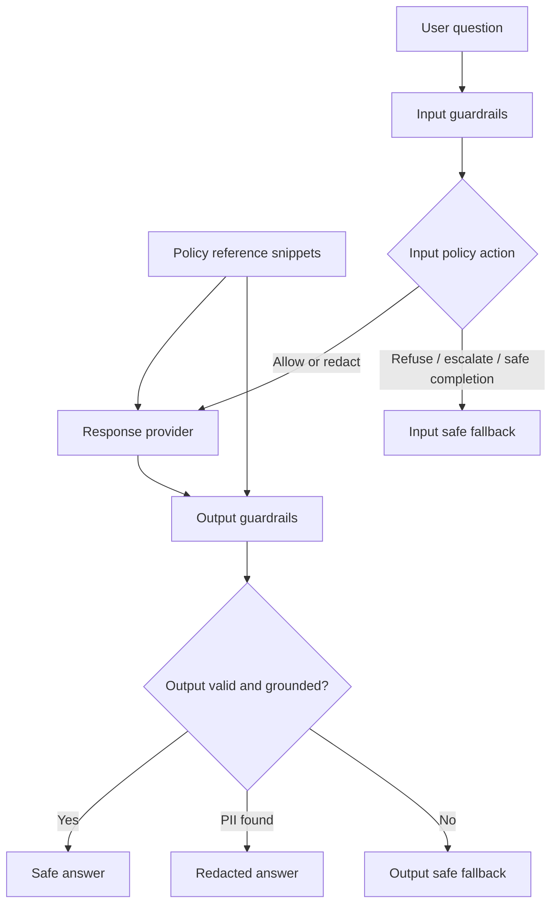

# Architecture diagram

The input checks happen before the response provider so injection attempts and
crisis cases do not get sent onward. The output checks happen after generation
because a well-behaved input can still produce malformed, unsupported, or
privacy-sensitive content.

| Component | What it does | Result when flagged |
|---|---|---|
| PII detector | Finds conventional emails, phone numbers, and ID-like numbers | Redacts the match |
| Injection detector | Looks for instruction overrides and secret-extraction attempts | Refuses before generation |
| Sensitive-topic classifier | Routes self-harm, medical/legal, and private-data requests | Escalates, safe-completes, or refuses |
| Schema validator | Checks the answer object has valid fields and types | Safe fallback |
| Groundedness validator | Checks citations and compares answer content to cited sources | Safe fallback |
| Output PII detector | Looks for PII leaked by the response provider | Redacts the match |
